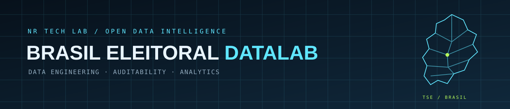

# Brasil Eleitoral DataLab

  

  
  
  
  
  
  

<strong>Uma plataforma aberta para descobrir, integrar, validar e analisar dados eleitorais brasileiros.</strong> 
Engenharia de dados · Auditoria reproduzível · Inteligência analítica

---

## Visão do projeto

O Brasil Eleitoral DataLab é uma plataforma independente de engenharia e análise de dados públicos do ecossistema eleitoral brasileiro. Reúne catálogo de fontes, pipelines de ingestão, validação de integridade, contratos de dados, transformação analítica e interfaces de exploração.

A referência de organização e documentação é o projeto [DataUrnas-BR](https://github.com/alissonlinneker/dataUrnas-BR): apresentação objetiva do escopo, destaques, arquitetura, pipeline, painel, instalação, uso, documentação, limitações e roadmap. O DataLab amplia o escopo para além da auditoria de arquivos de urna, estruturando diferentes domínios de dados eleitorais em uma arquitetura rastreável.

> [!IMPORTANT]
> A documentação distingue o que está implementado do que ainda depende de execução ou validação. A descoberta CKAN, downloader, extração segura, contratos e pipeline local possuem implementação. A ingestão integral de dados reais do TSE e a publicação de resultados eleitorais consolidados ainda não estão concluídas.

## Sumário

- [Destaques](#destaques)
- [Domínios de dados](#domínios-de-dados)
- [Painel analítico](#painel-analítico)
- [Arquitetura](#arquitetura)
- [Pipeline e metodologia](#pipeline-e-metodologia)
- [Instalação e execução](#instalação-e-execução)
- [Estrutura do projeto](#estrutura-do-projeto)
- [Estado atual e roadmap](#estado-atual-e-roadmap)
- [Fontes oficiais](#fontes-oficiais)
- [Limitações](#limitações)
- [Licença](#licença)

## Destaques

- Catálogo de dados públicos do TSE via CKAN, com paginação e checkpoint.
- Manifesto local com hash SHA-256 e rastreabilidade dos metadados.
- Download resiliente com streaming, retomada HTTP Range/ETag e verificação de integridade.
- Extração ZIP segura com limites de tamanho, validação de caminhos e CRC.
- Contratos versionados para schema, tipos, obrigatoriedade e chaves.
- Pipeline inicial Bronze / Silver / Gold com fixtures reproduzíveis.
- API Node.js, interface Next.js e aplicação analítica Streamlit.
- Testes automatizados e workflows de CI.

## Domínios de dados

| Domínio | Exemplos | Fonte prioritária |
|---|---|---|
| Resultados eleitorais | Votos por cargo, candidatura, partido, município, zona e seção | TSE |
| Candidaturas | Perfil, situação, partido, federação, bens e propostas | TSE |
| Eleitorado | Perfil agregado, comparecimento, abstenção e locais | TSE |
| Urnas e totalização | Boletins de urna, logs, RDV e arquivos de totalização | TSE |
| Financiamento | Receitas, despesas, doadores e fornecedores | TSE |
| Pesquisas | Registros, institutos, contratantes e resultados publicados | TSE |
| Partidos | Órgãos partidários e registros partidários | TSE |
| Geografia eleitoral | Municípios, zonas, seções e códigos geográficos | TSE / IBGE |
| Contexto institucional | Legislação, normas e dados públicos correlatos | Órgãos oficiais |

A inclusão de um domínio no escopo não significa que seus dados já estejam integrados. Disponibilidade, granularidade e periodicidade variam por conjunto.

## Painel analítico

O repositório possui duas interfaces complementares:

- Web Next.js: navegação, visão geral e catálogo.
- Streamlit: exploração interativa dos metadados coletados do catálogo CKAN.

O painel Streamlit apresenta gráficos de recursos por formato, conjuntos por órgão, distribuição temporal de criação e atualização, e conjuntos com maior quantidade de recursos. Os filtros permitem segmentar por órgão, formato e busca textual; a tabela filtrada pode ser exportada em CSV.

> Os gráficos atuais descrevem metadados do catálogo. Não representam votação. Indicadores de votos, comparecimento, abstenção ou desempenho de candidaturas só serão publicados após ingestão e validação dos arquivos oficiais correspondentes.

## Arquitetura

    Fontes oficiais (TSE / IBGE / Dados.gov.br)
                      |
                      v
          Descoberta e catálogo CKAN
                      |
                      v
         Ingestão / download / extração
                      |
                      v
           Bronze -> Silver -> Gold
                      |
              +-------+-------+
              |               |
              v               v
           Node API       DuckDB / Parquet
              |               |
              v               v
           Next.js          Streamlit
            Web UI        Analytics UI

| Componente | Tecnologia | Responsabilidade |
|---|---|---|
| Ingestão e qualidade | Python | Descoberta, download, checksum, extração e validação |
| Transformação | Python / Pandas | Normalização e publicação de camadas analíticas |
| API | Node.js | Exposição do catálogo e health checks |
| Web | Next.js / TypeScript | Interface pública e navegação |
| Analytics | Streamlit / Plotly | Gráficos e exploração interativa |
| Armazenamento analítico | Parquet / DuckDB (em evolução) | Consulta analítica |
| Persistência de serviço | PostgreSQL (planejado) | Dados transacionais e serviços compartilhados |

### Camadas de dados

- Bronze: preservação dos arquivos de origem, metadados, hashes e evidências de ingestão.
- Silver: padronização de schema, tipos, códigos e regras de qualidade.
- Gold: tabelas analíticas com granularidade, semântica e metodologia documentadas.

## Pipeline e metodologia

1. Descoberta dos conjuntos e recursos publicados no CKAN do TSE.
2. Geração de manifesto, hash SHA-256 e checkpoint de retomada.
3. Download com streaming, retomada HTTP Range/ETag e verificação de integridade.
4. Extração ZIP com validação de caminhos, limites de tamanho e teste CRC.
5. Validação por contratos de dados versionados.
6. Transformação inicial Bronze/Silver/Gold com fixtures normalizadas.
7. Exposição dos metadados via API e aplicações de exploração.

Os controles implementados incluem idempotência por hash, escrita atômica, retry/backoff, checkpoint, validação de schema e logs estruturados. A integração ponta a ponta com recursos reais do TSE ainda precisa ser executada em ambiente com acesso ao portal.

## Instalação e execução

### Requisitos

- Python 3.10+
- Node.js 20+
- Docker e Docker Compose (opcional)

### Descobrir o catálogo TSE

    git clone https://github.com/nrdataanalysis-1908/brasil-eleitoral-datalab.git
    cd brasil-eleitoral-datalab
    python -m venv .venv

Ative o ambiente virtual e instale as dependências:

    python -m pip install -e ".[dev]"
    python scripts/discover_tse_catalog.py

A descoberta requer acesso à internet. Os metadados são gravados localmente em catalog/tse/datasets/, incluindo manifesto e checkpoint.

### Iniciar o painel Streamlit

    python -m pip install -r apps/analytics/requirements.txt
    streamlit run apps/analytics/app.py

O painel lê o manifesto local produzido pela descoberta CKAN. Sem manifesto, informa o comando necessário e não cria gráficos com dados fictícios.

### Iniciar a stack completa

    docker compose up --build

Consulte a documentação da stack local para portas, variáveis e serviços.

## Estrutura do projeto

    brasil-eleitoral-datalab/
    ├── apps/
    │   ├── web/                 # Next.js / TypeScript
    │   └── analytics/           # Streamlit / Plotly
    ├── services/
    │   └── api/                 # API Node.js
    ├── src/brasil_eleitoral/
    │   ├── ckan/                # Cliente e catálogo CKAN
    │   ├── ingestion/           # Download e extração
    │   ├── validation/          # Contratos e qualidade
    │   ├── transformation/      # Bronze / Silver / Gold
    │   └── observability.py     # Logs e eventos
    ├── catalog/                 # Fontes e manifests locais
    ├── contracts/               # Contratos versionados
    ├── docs/                    # Arquitetura e documentação
    ├── examples/                # Fixtures reproduzíveis
    ├── scripts/                 # Entradas CLI
    └── tests/                   # Testes automatizados

## Estado atual e roadmap

| Capacidade | Estado |
|---|---|
| Cliente CKAN, paginação e descoberta | Implementado; execução real pendente |
| Manifesto, SHA-256 e checkpoint | Implementado |
| Downloader com retomada Range/ETag | Implementado; teste real de origem pendente |
| Extração ZIP segura | Implementado e coberto por testes |
| Contratos de dados e validações | Implementado e coberto por testes |
| Pipeline Bronze/Silver/Gold com fixtures | Implementado; Parquet/DuckDB pendentes |
| API de catálogo e health checks | Implementado; suíte API requer validação final |
| Web Next.js | Implementação inicial publicada |
| Streamlit com gráficos de metadados | Implementação em evolução |
| Ingestão integral de dados eleitorais reais | Pendente |
| Indicadores eleitorais Gold e mapas por UF | Pendente |
| Monitoramento gerenciado e alertas | Pendente |

## Fontes oficiais

- [Portal de Dados Abertos do TSE](https://dadosabertos.tse.jus.br/)
- [API CKAN do TSE](https://dadosabertos.tse.jus.br/api/3/action/package_search)
- [Estatísticas eleitorais do TSE](https://www.tse.jus.br/eleicoes/estatisticas)
- [IBGE](https://www.ibge.gov.br/)
- [Dados.gov.br](https://dados.gov.br/)

## Limitações

- A descoberta CKAN e o downloader ainda precisam de execução real contra o portal para confirmar disponibilidade e cobertura.
- O pipeline Medallion usa fixtures normalizadas; o mapeamento de todos os schemas nativos do TSE não está concluído.
- O Streamlit analisa metadados do catálogo, não resultados eleitorais.
- PostgreSQL, DuckDB/Parquet em produção, indicadores Gold e mapas geográficos oficiais permanecem em evolução.
- Dados agregados não autorizam inferências sobre escolhas ou comportamentos individuais.

## Referência documental

A organização da documentação toma como referência o [DataUrnas-BR](https://github.com/alissonlinneker/dataUrnas-BR). O escopo, a implementação, os dados e as conclusões do Brasil Eleitoral DataLab são próprios e não devem ser confundidos com os resultados daquele projeto.

## Licença

Código e documentação original sob licença MIT. A licença não altera termos de uso, direitos autorais ou condições de redistribuição dos dados publicados por órgãos externos. Consulte os metadados e a licença da fonte antes de redistribuir conjuntos.
