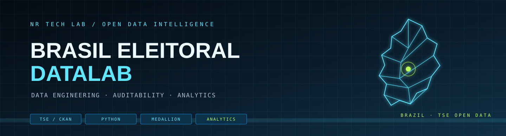
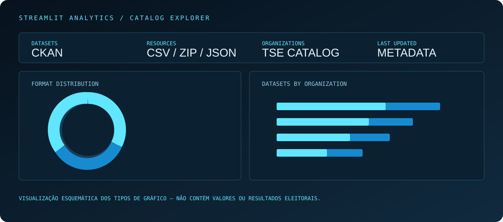
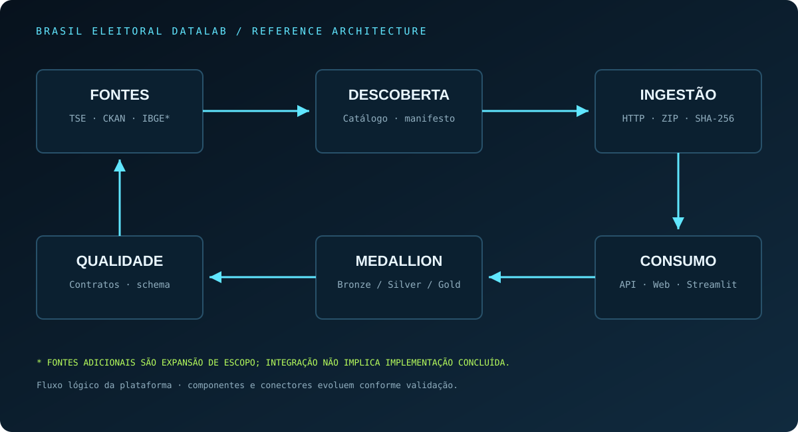
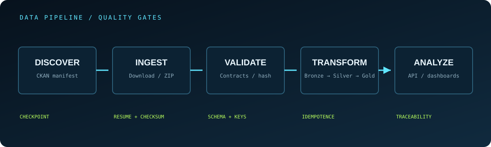

<p align="center">
  
</p>

<p align="center">
  <a href="https://img.shields.io/badge/Python-3.10%2B-3776AB"></a>
  <a href="https://img.shields.io/badge/Node.js-20%2B-339933"></a>
  <a href="https://img.shields.io/badge/Next.js-Web-000000"></a>
  <a href="https://img.shields.io/badge/HTML-Reports-168bd0"></a>
  <a href="https://img.shields.io/badge/Plotly-Charts-3F4F75"></a>
  <a href="https://img.shields.io/badge/Source-TSE-168bd0"></a>
</p>

# Brasil Eleitoral DataLab

Laboratório aberto de engenharia, auditoria e análise de dados eleitorais brasileiros. O projeto organiza fontes públicas, constrói pipelines reproduzíveis e prepara dados para exploração analítica com rastreabilidade da origem à publicação.

> Referência de apresentação e organização documental: [DataUrnas-BR](https://github.com/alissonlinneker/dataUrnas-BR). O DataLab possui escopo, código e metodologia próprios; não replica resultados nem afirmações daquele projeto.

---

## Sumário

- [Visão geral](#visão-geral)
- [Destaques técnicos](#destaques-técnicos)
- [Painel e relatórios](#painel-e-relatórios)
- [Arquitetura](#arquitetura)
- [Pipeline de dados](#pipeline-de-dados)
- [Domínios eleitorais](#domínios-eleitorais)
- [Metodologia e qualidade](#metodologia-e-qualidade)
- [Instalação](#instalação)
- [Execução](#execução)
- [Estrutura do repositório](#estrutura-do-repositório)
- [Estado atual e roadmap](#estado-atual-e-roadmap)
- [Fontes oficiais](#fontes-oficiais)
- [Limitações](#limitações)
- [Documentação](#documentação)
- [Licença](#licença)

---

## Visão geral

O Brasil Eleitoral DataLab foi concebido como uma plataforma modular para trabalhar com diferentes domínios do ecossistema eleitoral: resultados, candidaturas, eleitorado, financiamento, pesquisas, boletins de urna, totalização e geografia eleitoral.

O foco inicial é construir uma fundação confiável:

1. descobrir conjuntos e recursos publicados pelo TSE;
2. registrar metadados e versões do catálogo;
3. baixar arquivos com retomada e verificação de integridade;
4. extrair arquivos compactados com controles de segurança;
5. validar estruturas por contratos versionados;
6. transformar dados em camadas Bronze, Silver e Gold;
7. disponibilizar metadados e análises em interfaces dedicadas.

A plataforma diferencia explicitamente capacidades implementadas, integrações ainda não executadas e análises que dependem de dados eleitorais efetivamente processados.

## Destaques técnicos

- Cliente CKAN com paginação, timeout, retry/backoff e validação do envelope de resposta.
- Manifesto de catálogo com hash SHA-256 e checkpoint para retomada da descoberta.
- Downloader com streaming, retomada HTTP Range/ETag, checksum e escrita atômica.
- Extração ZIP defensiva contra path traversal, arquivos especiais e pacotes excessivos.
- Contratos versionados para tipos, nulabilidade, campos obrigatórios, valores permitidos e chaves.
- Pipeline inicial Bronze/Silver/Gold com fixtures reproduzíveis.
- API Node.js, interface principal Next.js e relatórios HTML autônomos gerados em Python.
- Testes automatizados e workflows de CI para os componentes do projeto.

## Painel e relatórios

A interface Next.js é o painel principal da plataforma e consulta os metadados pela API. O serviço Analytics gera relatórios HTML autônomos, responsivos e imprimíveis, sem depender de Streamlit. O relatório de catálogo apresenta:

- distribuição dos recursos por formato;
- conjuntos publicados por organização;
- evolução temporal de criação dos conjuntos;
- atualizações mensais do catálogo;
- conjuntos com maior quantidade de recursos.

Os filtros permitem segmentar por órgão, formato e busca textual. A tabela de resultados pode ser exportada em CSV.

<p align="center">
  
</p>

> A imagem acima documenta os tipos de visualização do painel; é um esquema ilustrativo, não uma captura da aplicação nem uma amostra de dados. Os gráficos em execução usam os metadados efetivamente presentes no manifesto local. Nesta etapa, eles não representam votos, candidatos, comparecimento ou abstenção.

### Executar o painel

```bash
python scripts/discover_tse_catalog.py
python -m pip install -r apps/analytics/requirements.txt
streamlit run apps/analytics/app.py
```

A descoberta exige acesso à internet. Sem o manifesto local, a aplicação informa como gerar o catálogo e não substitui dados ausentes por números fictícios.

## Arquitetura

<p align="center">
  
</p>

| Camada | Implementação | Responsabilidade |
|---|---|---|
| Fontes | TSE CKAN | Descoberta de conjuntos e recursos |
| Ingestão | Python | Download, retomada, checksum e extração |
| Qualidade | Python | Contratos, tipos, chaves e regras de validação |
| Transformação | Python | Normalização e camadas Medallion |
| API | Node.js | Catálogo e health checks |
| Web | Next.js / TypeScript | Navegação e consulta |
| Analytics | Python / HTML / CSS | Geração de relatórios autônomos de metadados |

A arquitetura representa o desenho lógico do sistema. Componentes marcados como planejados no roadmap não devem ser interpretados como serviços já implantados.

## Pipeline de dados

<p align="center">
  
</p>

| Etapa | Controles principais |
|---|---|
| Discover | Paginação, checkpoint e manifesto |
| Ingest | Streaming, retry, retomada Range/ETag |
| Validate | SHA-256, checksum, schema e chaves |
| Transform | Idempotência e separação Bronze/Silver/Gold |
| Analyze | API, catálogo web e painel exploratório |

### Camadas Medallion

- Bronze: preserva arquivos de origem, metadados, hashes e evidências de ingestão.
- Silver: normaliza tipos, códigos, nomes e estruturas conforme contratos.
- Gold: organiza tabelas analíticas com granularidade, semântica e regras documentadas.

## Domínios eleitorais

| Domínio | Exemplos de informação | Situação |
|---|---|---|
| Resultados eleitorais | Votos por cargo, candidatura, partido e território | Escopo |
| Candidaturas | Perfil, partido, situação, bens e propostas | Escopo |
| Eleitorado | Perfil agregado, comparecimento e abstenção | Escopo |
| Urnas e totalização | BU, logs, RDV e arquivos de totalização | Escopo |
| Financiamento | Receitas, despesas, doadores e fornecedores | Escopo |
| Pesquisas | Registros, institutos e contratantes | Escopo |
| Geografia eleitoral | Municípios, zonas, seções e códigos geográficos | Escopo |

“Escopo” indica domínio pretendido, não integração concluída. A publicação de indicadores depende de ingestão, validação e documentação da fonte.

## Metodologia e qualidade

A plataforma prioriza:

- proveniência: identificação da fonte, recurso, data de coleta e versão;
- integridade: hashes, checksums e validação de arquivos;
- contratos: schema explícito, tipos, nulabilidade e chaves;
- reprodutibilidade: checkpoint, idempotência e escrita atômica;
- observabilidade: logs estruturados e códigos de saída;
- transparência: cobertura, lacunas e limitações descritas junto aos resultados.

O contrato `contracts/tse/election-results.v1.json` representa um schema de destino normalizado. Ele não substitui o mapeamento dos diferentes layouts nativos publicados pelo TSE.

## Instalação

### Requisitos

- Python 3.10+
- Node.js 20+
- Docker e Docker Compose (opcionais)

### Clonar o repositório

```bash
git clone https://github.com/nrdataanalysis-1908/brasil-eleitoral-datalab.git
cd brasil-eleitoral-datalab
python -m venv .venv
```

Ativar o ambiente:

```bash
# Linux / macOS
source .venv/bin/activate

# Windows PowerShell
.venv\Scripts\Activate.ps1
```

Instalar dependências Python:

```bash
python -m pip install -e ".[dev]"
```

## Execução

### Descoberta do catálogo TSE

```bash
python scripts/discover_tse_catalog.py
```

O processo consulta a API CKAN e gera os metadados locais em `catalog/tse/datasets/`.

### Download dos recursos

```bash
python scripts/download_tse_resources.py --help
```

Consulte as opções e o manifesto gerado pela descoberta antes de iniciar downloads em lote.

### Relatórios HTML

```bash
python -m pip install -r apps/analytics/requirements.txt
streamlit run apps/analytics/app.py
```

### Stack Docker — build local

```bash
docker compose up --build
```

### Executar imagens publicadas no GHCR

Para iniciar API, Web e Analytics sem reconstruir as imagens:

```powershell
$env:IMAGE_TAG = "v0.1.0-alpha.2"
docker compose -f docker-compose.ghcr.yml pull
docker compose -f docker-compose.ghcr.yml up -d
```

Gere primeiro o catálogo local com `python scripts/discover_tse_catalog.py`. Consulte [o guia de execução das imagens GHCR](docs/ghcr-deployment.md) para autenticação, portas e solução de problemas.

Consulte [docs/development-stack.md](docs/development-stack.md) para a composição de desenvolvimento com build local.

## Estrutura do repositório

```text
brasil-eleitoral-datalab/
├── apps/
│   ├── web/                    # Next.js / TypeScript
│   └── analytics/              # Gerador de relatórios HTML
├── services/
│   └── api/                    # API Node.js
├── src/brasil_eleitoral/
│   ├── ckan/                   # Cliente e catálogo CKAN
│   ├── ingestion/              # Download e extração segura
│   ├── validation/             # Contratos e qualidade
│   ├── transformation/         # Bronze / Silver / Gold
│   └── observability.py        # Logs estruturados
├── contracts/                  # Contratos versionados
├── catalog/                    # Manifestos e metadados locais
├── docs/                       # Arquitetura e documentação
├── examples/                   # Fixtures reproduzíveis
├── scripts/                    # Entradas CLI
└── tests/                      # Testes automatizados
```

## Estado atual e roadmap

| Capacidade | Estado |
|---|---|
| Cliente CKAN, paginação e descoberta | Implementado; execução real pendente |
| Manifesto, SHA-256 e checkpoint | Implementado |
| Downloader com retomada Range/ETag | Implementado; validação com origem real pendente |
| Extração ZIP segura | Implementado e coberto por testes |
| Contratos e validação de dados | Implementado e coberto por testes |
| Pipeline Bronze/Silver/Gold | Implementação inicial com fixtures normalizadas |
| API de catálogo e health checks | Implementada; 4 testes automatizados aprovados no GitHub Actions |
| Interface Next.js | Implementação inicial |
| Relatórios HTML autônomos | Gerador implementado; validação local pendente |
| Ingestão integral de dados eleitorais reais | Pendente |
| Indicadores eleitorais Gold | Pendente |
| Mapas oficiais por UF | Pendente |
| DuckDB / Parquet como camada analítica | Pendente |
| PostgreSQL para persistência de serviço | Planejado |
| Monitoramento gerenciado e alertas | Pendente |

## Fontes oficiais

- [Portal de Dados Abertos do TSE](https://dadosabertos.tse.jus.br/)
- [API CKAN do TSE](https://dadosabertos.tse.jus.br/api/3/action/package_search)
- [Estatísticas eleitorais do TSE](https://www.tse.jus.br/eleicoes/estatisticas)
- [IBGE](https://www.ibge.gov.br/)
- [Portal Brasileiro de Dados Abertos](https://dados.gov.br/)

## Limitações

- A descoberta CKAN e o downloader precisam de execução real contra o portal para confirmar cobertura e disponibilidade.
- O pipeline Medallion foi validado com fixtures normalizadas; o mapeamento integral dos schemas nativos do TSE ainda não está concluído.
- Os gráficos atuais analisam metadados do catálogo, não resultados eleitorais.
- DuckDB/Parquet, PostgreSQL, indicadores Gold e mapas geográficos oficiais permanecem em evolução.
- Dados agregados não autorizam inferências sobre escolhas ou comportamentos individuais.
- O projeto não substitui auditorias oficiais, fiscalização eleitoral ou perícia independente.

## Documentação

- [Fontes e catálogo de dados](docs/data-sources.md)
- [Descoberta CKAN](docs/ckan-discovery.md)
- [Download de recursos](docs/resource-downloads.md)
- [Extração segura](docs/safe-extraction.md)
- [Contratos de dados](docs/data-contracts.md)
- [Pipeline Medallion](docs/medallion-pipeline.md)
- [Operação e observabilidade](docs/operations.md)
- [Stack de desenvolvimento](docs/development-stack.md)
- [Execução das imagens publicadas no GHCR](docs/ghcr-deployment.md)
- [Relatórios HTML](docs/html-reports.md)

## Licença

Código original sob licença MIT. Os conjuntos de dados de terceiros permanecem sujeitos às licenças e condições dos respectivos órgãos publicadores.
